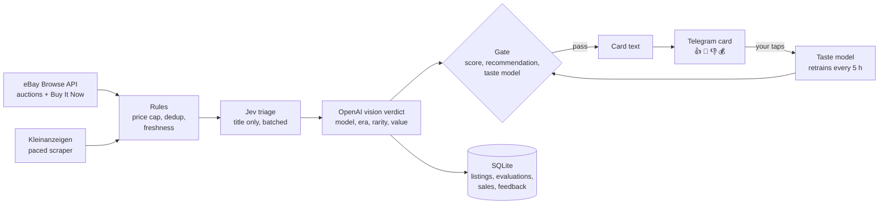

# WatchHunter

A personal deal hunter for collectible **vintage digital watches** (LCD, LED,
calculator, ana-digi). It watches eBay and Kleinanzeigen, looks at the photos
with a vision model, and sends the few listings worth a look to Telegram. Every
👍 / 👎 you tap under a card trains a small taste model, so the bot gets closer to
what *you* collect.

It runs 24/7 on a Raspberry Pi for about **$0.05–0.20 a day** in model calls.



## What makes it different

| | Typical listing monitors | WatchHunter |
|---|---|---|
| New-listing alerts | yes | yes |
| Reads the photos | no | yes: model number, case, bracelet, dial text, year on the display |
| Rarity and value | no | rarity tier + value range, calibrated against recorded hammer prices |
| Learns your taste | no | logistic regression on your Telegram reactions, auto-retrained |
| Cost per useful find | n/a | a few cents |

## Pipeline

1. **Fetch.** eBay Browse API (OR-grouped keywords, auctions + Buy It Now) and
   Kleinanzeigen search pages with a rate limiter and a block cooldown.
   Kleinanzeigen photos are fetched in full size from the listing page.
2. **Cheap rules.** Price incl. shipping ≤ `MAX_TOTAL_EUR`, already seen,
   already rejected, ended, stale Buy It Now listings.
3. **Triage (text).** Jev (TypeSafe) scores titles in batches
   against the buying criteria; OpenAI nano is the fallback.
4. **Verdict (vision).** `gpt-5-mini` with a strict JSON schema: brand, model,
   era, rarity, value range, fake risk, recommendation. The prompt checks the
   claimed model against what the photos show (case material, bracelet,
   printed words), knows the current-production Casio line-up, and skips
   anything that is not a wristwatch.
5. **Gate.** `MIN_SCORE`, recommendation, optional `MIN_RARITY` /
   `MIN_PROFIT_EUR`, and the taste model threshold (with a small exploration
   rate so it keeps learning).
6. **Card.** Only for finds: a second short call writes the story, why it was
   picked and what to check. Optional web search for sold prices.
7. **Telegram.** Big photo, five-line caption, details in a collapsed quote,
   buttons: 👍 interesting · 💸 right watch, wrong price · 👎 not for me ·
   💰 would buy. `/stats` shows the last 24 h.
8. **Learning loop.**
   - Every evaluated auction is followed to its end, and the final price
     lands in a sales table that calibrates the value estimates.
   - Perceptual image hashes flag photos reused across listings.
   - Your reactions retrain the taste model every 5 hours.

## Numbers (from my own runs, November 2026)

- **Taste model:** 1,277 rated listings, 116 positive.
  - Cross-validated AUC: logistic regression 0.944, random forest 0.924.
  - At the live threshold it sends about 1 in 5 listings and keeps about 90% of
    the ones I liked.
- **Rarity benchmark** (`bench/rarity_bench.py`, 95 live listings, 17
  references): 84% tier accuracy, 27 of 29 rare pieces found. See
  [bench/RARITY.md](bench/RARITY.md).
- **Cost:**
  - Verdict about $0.0005 per listing, card text about $0.0013 per find.
  - Normal operation is $0.05–0.20 a day; a hard daily cap (`MAX_DAILY_COST_USD`)
    stops model calls.

## Setup

Python 3.12.

```sh
python3.12 -m venv .venv
.venv/bin/pip install -r requirements.txt -r requirements-dev.txt -e .
cp .env.example .env                     # then fill in the keys
.venv/bin/python -m watchhunter check    # tests eBay, OpenAI, Jev and Telegram keys
.venv/bin/python -m watchhunter          # run
```

Keys you need (all in `.env`, never committed):

| Key | Where |
|---|---|
| `EBAY_CLIENT_ID`, `EBAY_CLIENT_SECRET` | eBay developer program, production keyset (Browse API) |
| `OPENAI_API_KEY` | OpenAI |
| `TYPESAFE_API_KEY` | Jev triage (optional; `TRIAGE_PROVIDER=openai` works without it) |
| `TELEGRAM_BOT_TOKEN`, `TELEGRAM_CHAT_ID` | @BotFather and your chat id |

Useful settings:
- **Search:** `EBAY_KEYWORDS` and `BUY_NOW_KEYWORDS` (use `a|b` inside one
  keyword for an OR group), `KLEINANZEIGEN_KEYWORDS`.
- **Gate:** `MAX_TOTAL_EUR`, `MIN_SCORE`, `MIN_RARITY`, `TASTE_THRESHOLD`,
  `TASTE_EXPLORE_RATE`.

Only one instance runs at a time (file lock in `data/`).

### Run on a Raspberry Pi

A systemd user service keeps it alive and restarts it after a crash or reboot:

```ini
# ~/.config/systemd/user/watchhunter.service
[Service]
WorkingDirectory=%h/watchhunter
ExecStart=%h/watchhunter/.venv/bin/python -m watchhunter
Restart=always
RestartSec=30

[Install]
WantedBy=default.target
```

```sh
loginctl enable-linger $USER
systemctl --user enable --now watchhunter
```

## Training your own taste

```sh
# 200 varied listings, rate them in Telegram
.venv/bin/python scripts/label_session.py 200
# focus on one brand, any price
LABEL_BRAND=casio LABEL_KEYWORDS="casio uhr,casio" LABEL_MAX_PRICE=1000 \
  .venv/bin/python scripts/label_session.py 200
# what the live rules would send: measures precision
.venv/bin/python scripts/good_session.py 100
# replay your ratings against the rules
.venv/bin/python bench/feedback_bench.py
```

## Layout

```
src/watchhunter/
├── domain/            Listing, WatchEvaluation, rarity, reference keys
├── application/       ports, ListingFilter, DealEvaluator, scan + notify use cases
├── infrastructure/
│   ├── ebay/          Browse API adapter (+ legacy HTML adapter, opt-in only)
│   ├── kleinanzeigen/ paced search + gallery scraper
│   ├── jev/           batched title triage
│   ├── openai_api/    budget-aware client, verdict / card / web check
│   ├── llm/           prompts and strict JSON schemas
│   ├── images/        perceptual hash index
│   ├── telegram/      cards, buttons, /stats, feedback polling
│   └── persistence/   SQLAlchemy async + SQLite
├── sales/             auction follow-up and hammer-price stats
├── learning/          taste model (TF-IDF + verdict features, logreg / random forest)
├── scheduler/         APScheduler jobs
└── container.py       wiring
bench/                 rarity and feedback benchmarks
scripts/               labeling sessions, triage check, sample card
docs/                  ROADMAP.md, TOOLS.md
```

## Notes

- **Kleinanzeigen.** Its terms do not allow automated access. The adapter is
  slow on purpose (a few requests a minute, it pauses on 403/429) and is meant
  for personal use only.
- **eBay.** Use the official Browse API. The HTML adapter is kept only as an
  explicit opt-in: scraping eBay got my IP blocked.
- **Taste model.** It is personal. It learns from one collector's taps and is
  not a market model.

Tests: `make test`.

## License

MIT, see [LICENSE](LICENSE).
